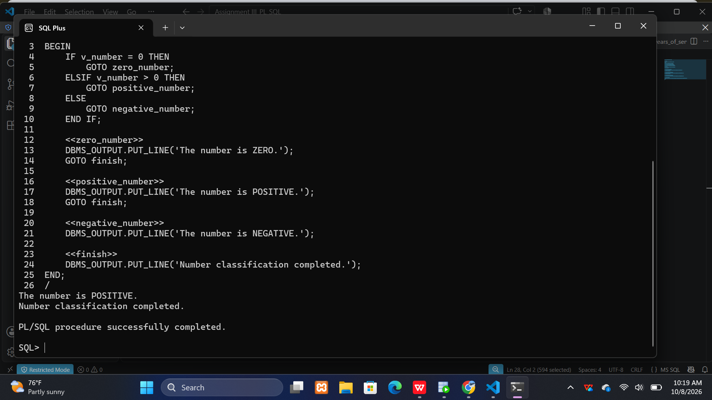
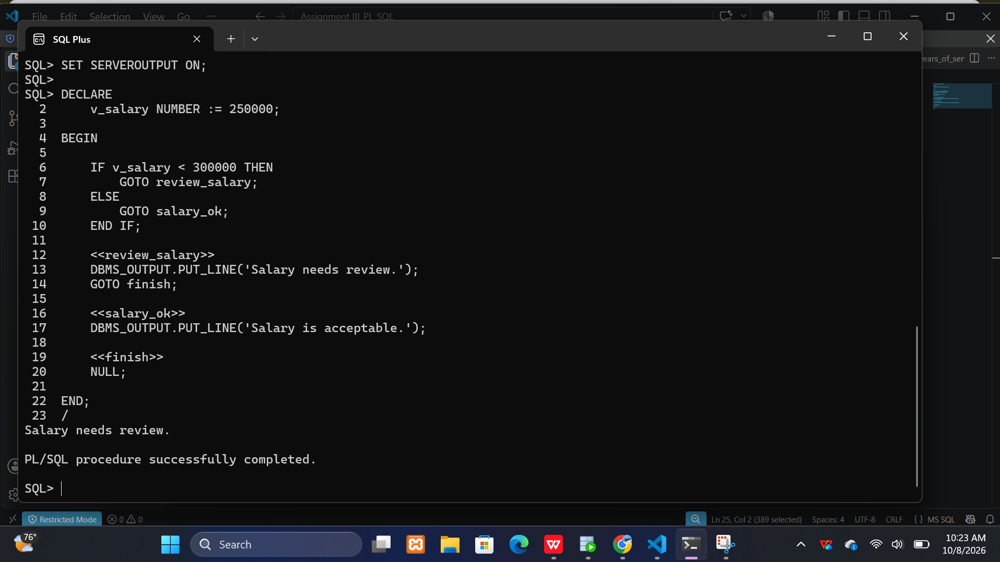
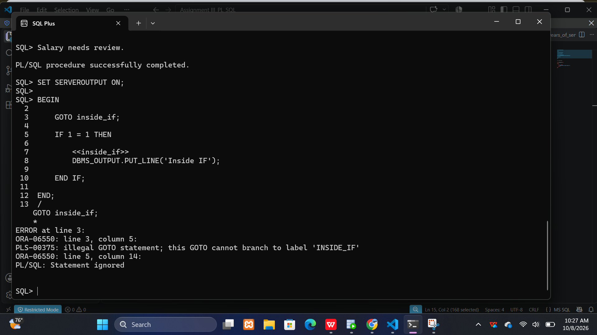
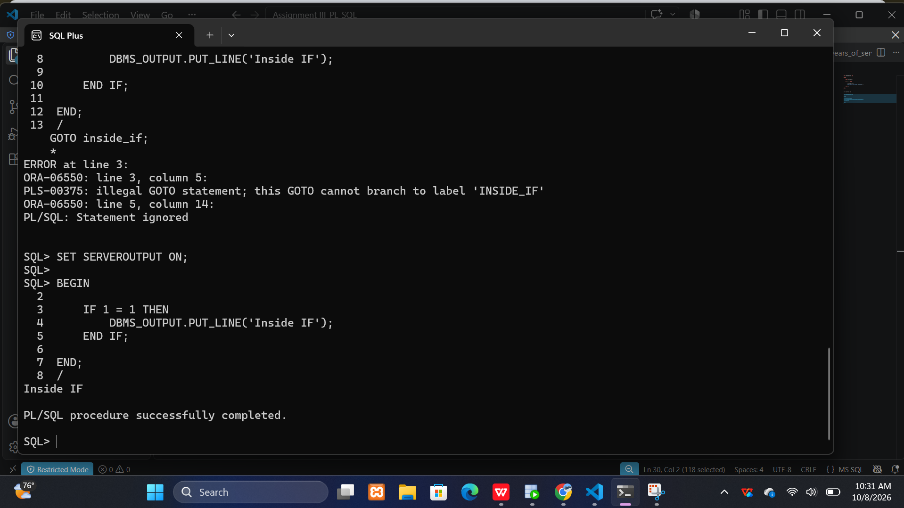
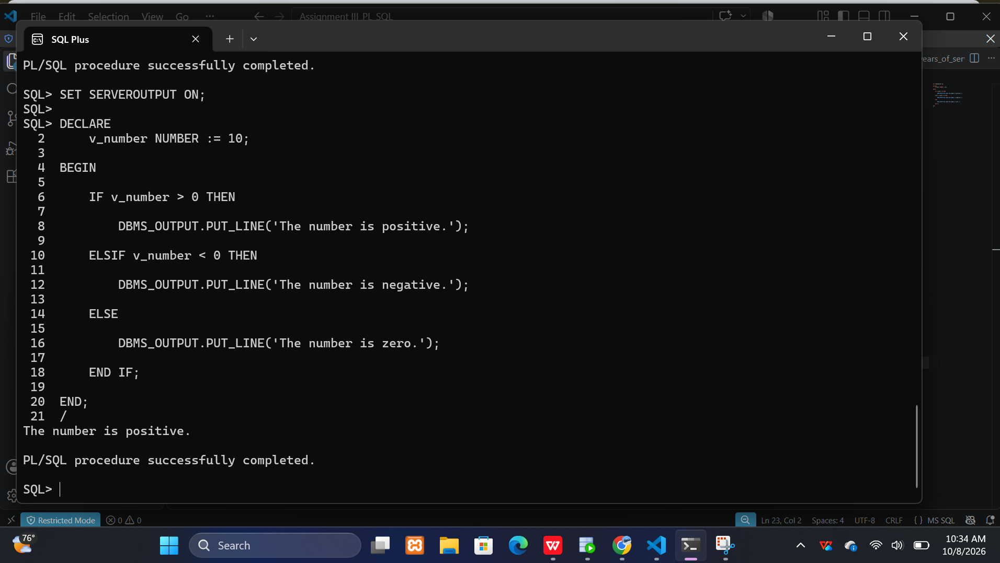
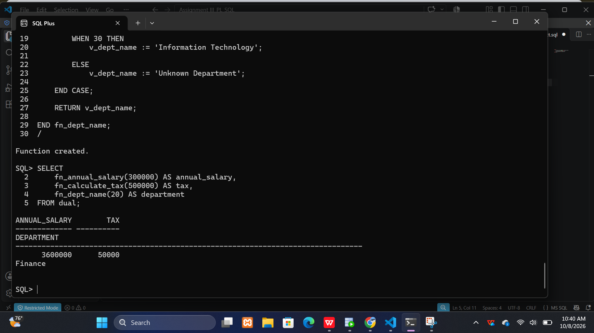

PL/SQL GOTO Statements and Functions

Name: Ndayisenga Kevin

Student ID: 29397

Course: Database Development with PL/SQL (INSY 8311)

1. Introduction

The project demonstrates the use of PL/SQL GOTO statements, stored functions, exception handling, functions used in SQL statements, and a payroll validation function.
The work is divided into three main parts: Part A focuses on GOTO statements, Part B focuses on PL/SQL functions, and Part C combines functions and validation.

2.Objectives

The main objectives of this assignment are to:

. Understand how GOTO statements work in PL/SQL.

. Create and use PL/SQL stored functions.

. Use conditional statements in PL/SQL.

. Handle exceptions in PL/SQL.

. Use stored functions inside SQL SELECT statements.

. Create a payroll validation function.

3. Part A GOTO Statements

A1  Number Classifier

The A1 program demonstrates the use of a GOTO statement to classify a number.
The program checks whether the number is positive, negative, or zero and transfers execution to the appropriate labelled section.

File:

01_goto/A1_number_classifier.sql

Result:

The program displays the classification of the given number.

A2  Salary Review

The A2 program uses GOTO statements to review and classify an employee's salary.
The salary is classified according to the conditions implemented in the program.

File:

01_goto/A2_salary_review.sql

Result:
The program displays the appropriate salary category.

A3  Illegal GOTO and Fix

The A3 program demonstrates an incorrect GOTO statement and then provides a corrected version.
The purpose is to understand the rules and limitations of GOTO statements in PL/SQL.

File:

01_goto/A3_illegal_goto.sql

Result:

The corrected program executes successfully using a valid label.

A4  Rewrite Without GOTO

The A4 program rewrites the logic without using GOTO statements.
Conditional statements such as IF, ELSIF, and ELSE are used instead.

File:

01_goto/A4_rewrite_no_goto.sql

Result:

The program produces the required result without using GOTO.

5. Part B  Functions

B1  Annual Salary

The B1 function calculates an employee's annual salary from the monthly salary.

File:

02_functions/B1_fn_annual_salary.sql

B2  Years of Service

The B2 function calculates an employee's years of service using the employee's hire date.

File:

02_functions/B2_fn_years_of_service.sql

B3  Tax Calculator

The B3 function calculates tax based on the employee's salary.

File:

02_functions/B3_fn_calculate_tax.sql

B4  Department Name

The B4 function receives a department ID and returns the corresponding department name.
Exception handling is included for cases where the department does not exist.

File:
02_functions/B4_fn_dept_name.sql

B5  Functions in SQL

B5 demonstrates how stored PL/SQL functions can be used inside a SQL SELECT statement.
The query uses the functions created in Part B to display employee information and calculated values.

File:

03_tests/B5_functions_in_select.sql

6. Part C  Combined Task

C1  Payroll Validator

The C1 payroll validator checks whether payroll information is valid.
The function checks the employee and salary information and returns an appropriate validation message.

File:

02_functions/C1_fn_validate_payroll.sql
The function is tested using SQL statements in the test folder.

7. Results and Screenshots

The results of the practical exercises are documented using screenshots.
A1 Output
The screenshot shows the result of the Number Classifier program.
screenshots/A1_output.png

A2 Output
The screenshot shows the result of the Salary Review program.
screenshots/A2_output.png

A3 Output
The screenshot shows the illegal GOTO error and the corrected version.
screenshots/A3_error_and_fix.png

A4 Output
The screenshot shows the result of the program rewritten without GOTO.
screenshots/A4_output.png

B5 Output
The screenshot shows functions being used inside a SQL SELECT statement.
screenshots/B5_select_output.png

C1 Output
The screenshot shows the result of the Payroll Validator function.
screenshots/C1_output.png

8. Business and Technical Interpretation.

The examples in this project demonstrate how PL/SQL can be used to process employee and payroll information.
GOTO statements demonstrate program control flow, while stored functions demonstrate how reusable calculations and validation logic can be created.
Using functions inside SQL statements makes it possible to apply reusable PL/SQL logic directly when retrieving database information.
Exception handling also helps the programs deal with invalid or missing data without causing unexpected termination.

9. Challenges and Solutions.

One challenge was understanding how GOTO statements and labels work in PL/SQL.
This was addressed by creating simple examples and testing the programs with different values.
Another challenge was creating functions that could retrieve information from database tables.
This was addressed by using SELECT INTO statements and exception handling.
Testing each program separately also helped identify and correct errors before moving to the next task.

10. Conclusion.

This assignment provided practical experience with PL/SQL GOTO statements and stored functions.
The project demonstrates how PL/SQL can be used to control program execution, perform calculations, retrieve database information, handle exceptions, and validate payroll data.
The project was tested using Oracle Database, and the results are documented using screenshots.

